# Hey, I'm Ronald Lenser

I build websites, web apps and automations with AI and ship them fast. Founder of [Ron Lenser Digital](https://www.ronlenserdigital.com) in Fredericksburg, VA.

I don't hand code. I direct AI tools like Claude and Claude Code to design, build, test and deploy real software for real businesses. **54 projects shipped since 2025.**

**[See the full portfolio with screenshots](https://ronaldlenser.github.io)**

## Latest: Lead Gen Automation

6 n8n workflows and one Google Sheet that run my agency's lead gen on autopilot. Scrapes local contractors with no website, verifies it 9 ways with search APIs and Claude, sends a personal 3 email sequence, sorts replies and builds my sales pipeline. **[See how it works](https://ronaldlenser.github.io/lead-gen-automation/)**

## Featured work

| Project | What it is | Stack | Link |
|---|---|---|---|
| [Lead Gen Automation](https://ronaldlenser.github.io/lead-gen-automation/) | 6 n8n workflows that find local businesses with no website, verify it 9 ways, write personal emails with Claude, sort replies and build a sales pipeline. | n8n, Claude, Google Sheets, Gmail, Apify, Serper | [breakdown](https://ronaldlenser.github.io/lead-gen-automation/) · [code](https://github.com/RonaldLenser/lead-gen-automation) |
| [Ron Lenser Digital](https://www.ronlenserdigital.com/) | Agency site. React + Vite + Tailwind, prerendered SEO pages, deployed on Vercel. | React, Vite, Tailwind, Vercel | [code](https://github.com/ronlenserdigital/ronlenserdigital-v2) |
| [CIPHER_](https://cipher-swart-omega.vercel.app/) | End to end encrypted messaging app. Discord style Circles, user held keys, panic wipe, Windows desktop build. Sells $199.99 Circle Keys. | Next.js, Supabase, Tauri, Vercel | [showcase](https://github.com/RonaldLenser/cipher-encrypted-messenger) |
| [TutorTime](https://tutortimeact.com/) | Tutoring web app for ACT and SAT prep with booking flow and score focused landing pages. | JavaScript, HTML, CSS | [code](https://github.com/RonaldLenser/websites/tree/main/software-and-ai/tutortime) |
| [Helix Research Technologies](https://ronlenserdigital.github.io/helix-website/) | Site for an AI agent agency serving lab and medical supply companies. | TypeScript | [code](https://github.com/RonaldLenser/websites/tree/main/software-and-ai/helix-research-technologies) |
| [BHR Custom Homes](https://bhrcustomhomes.com/) | Luxury custom home builder rebrand and site. | HTML, CSS, JS | [code](https://github.com/RonaldLenser/websites/tree/main/contractors-and-home-services/bhr-custom-homes) |
| [Seguro Insurance Center](https://seguroinsurancecenter.com/) | Auto insurance, SR-22 and FR-44 agency site. | HTML, CSS, JS | [code](https://github.com/RonaldLenser/websites/tree/main/professional-services/seguro-insurance) |
| [THE MOT1VATOR](https://ronlenserdigital.github.io/the-mot1vator/) | Motivational clothing brand site. | HTML, CSS, JS | [code](https://github.com/RonaldLenser/websites/tree/main/brands-and-retail/the-mot1vator) |
| [PabloHoney Bikes](https://ronlenserdigital.github.io/pablohoney-bikes/) | Mountain bike shop redesign. | HTML, CSS, JS | [code](https://github.com/RonaldLenser/websites/tree/main/brands-and-retail/pablohoney-bikes) |

## Everything else

**Automation**  
[Lead Gen Automation](https://ronaldlenser.github.io/lead-gen-automation/)

**Software & AI**  
[Ron Lenser Digital](https://www.ronlenserdigital.com/) · [CIPHER_](https://cipher-swart-omega.vercel.app/) · [TutorTime](https://tutortimeact.com/) · [Helix Research Technologies](https://ronlenserdigital.github.io/helix-website/) · [Onyx Supplements SEO Audit](https://ronlenserdigital.github.io/onyxsupps-seo-audit/) · [Stormline](https://ronlenserdigital.github.io/chasethestorm/) · [Top-Tier Leads Dashboard](https://ronlenserdigital.github.io/getontheroof/)

**Contractors & Home Services**  
[BHR Custom Homes](https://bhrcustomhomes.com/) · [America Affordable Home Improvement](https://americahomeimprovement.org/) · [Bright Renovations](https://ronlenserdigital.github.io/bright-renovations/) · [Impact Concrete Breaking](https://ronlenserdigital.github.io/impact-concrete-breaking/) · [Burns Landscaping](https://ronlenserdigital.github.io/burnslandscaping/) · [Pinpoint Calibration Service](https://pinpointcalibrationservice.com/) · [The Polished Abode](https://ronlenserdigital.github.io/the-polished-abode/) · [Ozark Elite Detailing](https://ronlenserdigital.github.io/ozarkelite/) · [NatuFresh](https://ronlenserdigital.github.io/NatuFresh/) · [Quality Care Janitorial](https://ronlenserdigital.github.io/qualitycareservices/) · [Nova Auto Repair](https://ronlenserdigital.github.io/novaautorepair/) · [Sitto's Computer Repair](https://ronlenserdigital.github.io/SittoComputerRepair/) · [L&M Integrations](https://ronlenserdigital.github.io/lm-integrations/)

**Professional Services**  
[Seguro Insurance Center](https://seguroinsurancecenter.com/) · [Tate Life Insurance](https://ronlenserdigital.github.io/tateinsurance/) · [Talaya Thomas](https://ronlenserdigital.github.io/talaya-thomas/) · [KBA Audit & Advisory](https://ronlenserdigital.github.io/kba-audit-advisory/) · [Wigand Bookkeeping](https://ronlenserdigital.github.io/wigand-bookkeeping/) · [40 to Freedom](https://ronlenserdigital.github.io/40freedom/) · [Legacy Architect RVA](https://ronlenserdigital.github.io/legacy-architect-rva/) · [Business Outcome Engineering](https://ronlenserdigital.github.io/businessoutcomeengineering/) · [ClearPathLocal](https://ronlenserdigital.github.io/clearpathlocal/) · [Mendi Baron, LCSW](https://ronlenserdigital.github.io/mendi2/) · [Tania Home Health](https://ronlenserdigital.github.io/tania/) · [Embracing Our Seniors](https://ronlenserdigital.github.io/seniorhousing/) · [Credit by Cre](https://github.com/ronlenserdigital/credit-by-cre)

**Brands & Retail**  
[THE MOT1VATOR](https://ronlenserdigital.github.io/the-mot1vator/) · [PabloHoney Bikes](https://ronlenserdigital.github.io/pablohoney-bikes/) · [In Her M Era](https://ronlenserdigital.github.io/in-her-m-era/) · [HEIM](https://ronlenserdigital.github.io/heim/) · [STITCHED](https://ronlenserdigital.github.io/vantara/) · [Grounded Gems](https://ronlenserdigital.github.io/grounded-gems/) · [Chasing Cards Solutions](https://chasingcardssolutions.com/) · [This is Siphokazi](https://ronlenserdigital.github.io/thisissiphozaki/) · [The PLUGG EV](https://ronlenserdigital.github.io/denise2/)

**Food, Events & Lifestyle**  
[Stockyard's Restaurant & Bar](https://ronlenserdigital.github.io/stockyards/) · [Honey's Cafe & Social](https://ronlenserdigital.github.io/honeys-cafe-social/) · [Pop N' Pour & Ace of Spirits](https://ronlenserdigital.github.io/popnpourace/) · [Golden Limousine](https://ronlenserdigital.github.io/thegoldenlimo/) · [JC Photography](https://ronlenserdigital.github.io/jcproductions/) · [The Fifth Pentacle](https://ronlenserdigital.github.io/the5thpentacle/) · [Fredericksburg Golf Center](https://ronlenserdigital.github.io/fxbggolf/)

**Sports & Training**  
[Dreamchasers Basketball](https://ronlenserdigital.github.io/dreamchasers-training/) · [Kali Strikes Defense Co.](https://ronlenserdigital.github.io/kali-strikes/) · [Spotsylvania Soccer Club](https://ronlenserdigital.github.io/spotsysoccerclub/) · [Allred Athletics](https://github.com/ronlenserdigital/allred-athletics)

## Tools

Claude · Claude Code · n8n · React · Vite · Tailwind · HTML/CSS/JS · Vercel · GitHub Pages · Supabase · Shopify · Figma

## Contact

[ronlenserdigital.com](https://www.ronlenserdigital.com) · [ron@ronlenserdigital.com](mailto:ron@ronlenserdigital.com) · [LinkedIn](https://linkedin.com/in/ronlenser) · (540) 395-6493

Source for client builds lives at [@ronlenserdigital](https://github.com/ronlenserdigital).
